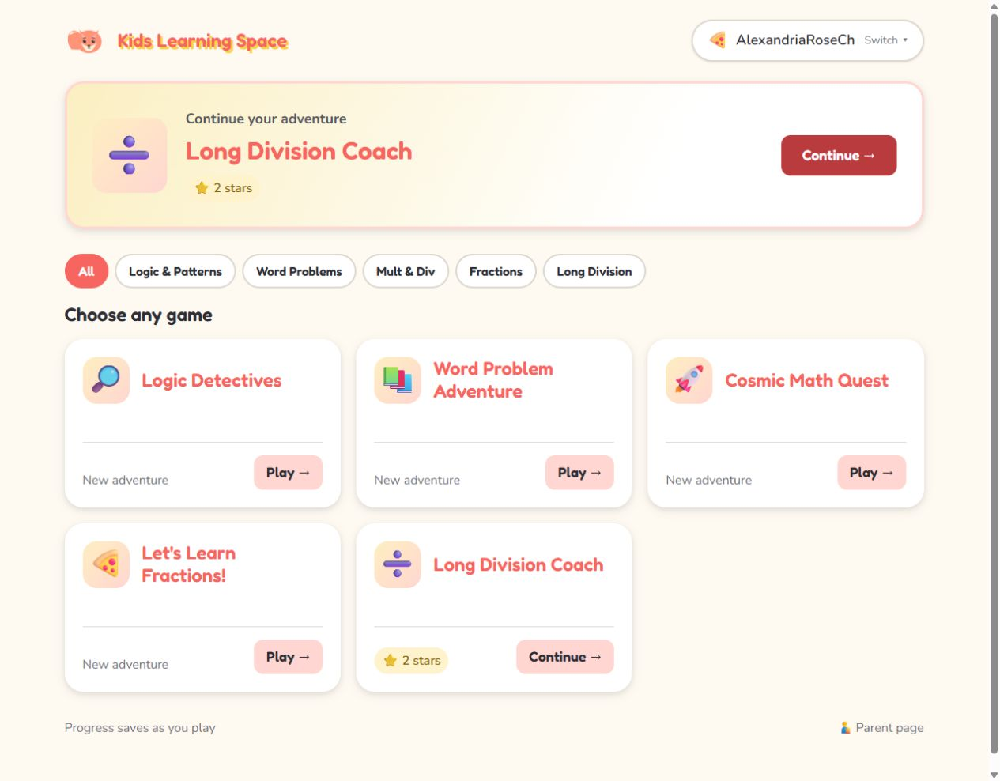
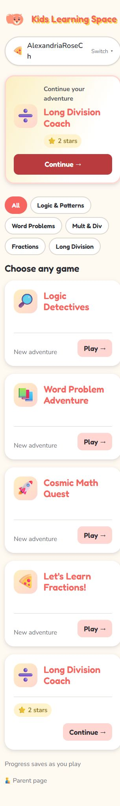
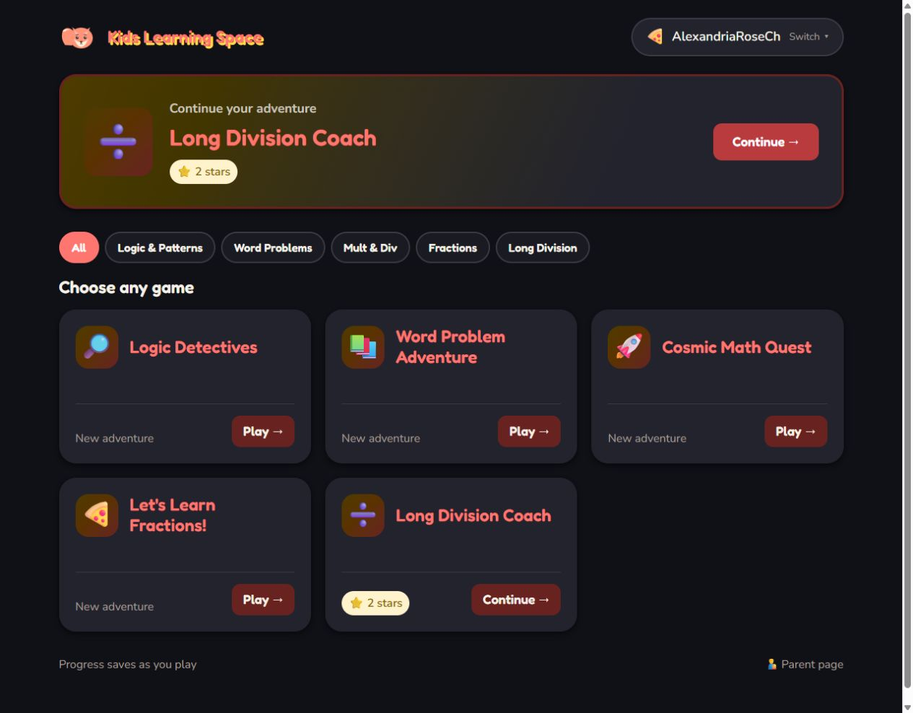

# Dashboard: Continue spotlight + game shelf

Implemented November 3, 2026. The hub highlights the active child's most
recently played registered game with a non-null checkpoint. Missing or
unparseable timestamps rank oldest; registry order breaks ties. No saved
checkpoint means no spotlight. Topic filters change only the library.

Game cards show complete names, real star/sticker totals, and Play or Continue.
Checkpoints without rewards show **Saved adventure**; untouched games show
**New adventure**. Each card has one accessible link with a visible action.
The library uses three columns from 1000px, two from 640px, and one below that.

Storage keys, backup formats, game routes, individual game asset versions,
and save-before-navigation behavior are unchanged. Only the shared hub CSS
and router release queries changed to `20261103-hub-spotlight-r1`.

## Automated verification

Passed:

```text
node --check shared/scripts/hub.js
node tests/smoke-hub-dashboard.mjs
node tests/smoke-save-session.mjs
node tests/smoke-parent-restore-ui.mjs
git diff --check
```

Dashboard coverage uses the real hub and progress modules with a minimal DOM:
registered checkpoints, null versus opaque false/zero state, dates and ties,
profile isolation, actual rewards, reset, replace import, cross-tab restore
notifications, filter independence, and accessible card links. It also checks
focus preservation, including when a live update changes the featured game.
The save-session test now checks router/CSS releases independently of game
asset versions.

## Browser verification

Used an isolated loopback origin with test-only profiles, separate from the
family's existing `file://` and launcher storage. No progress was injected.

- At 320px, 768px, and 1280px: one/two/three columns, full titles, no horizontal
  overflow or clipped text, and action targets at least 44 CSS pixels high.
- A long nickname at the existing profile-name limit wraps inside the switcher.
- A completed `84 ÷ 4` coached lesson earned two stars. Both the spotlight and
  library showed those actual rewards. Both Continue links reopened the saved
  Long Division session; the keyboard-operated spotlight also worked.
- Topic filtering left the spotlight unchanged and preserved filter focus.
- A new second profile showed no spotlight and zero rewards. Saving an
  unfinished Logic Detectives case showed **Saved adventure**. Switching back
  restored the first profile's Long Division spotlight and two stars.
- Save-and-return to Hub succeeded in both games. No console errors occurred.
- Dark colors and reduced-motion declarations were rendered in a temporary
  copy forcing the existing CSS media blocks. The dark surfaces remained
  readable; computed motion durations were 0.01ms and hovered filters had no
  transform. The temporary files were removed; system preferences were not
  changed.
- The embedded browser did not apply browser zoom shortcuts. Reflow at the
  equivalent 640 CSS-pixel viewport for 200% zoom on a 1280px display passed
  without overflow or clipping. Native browser 200% zoom remains a manual check.

## Captures

These show earned progress in an isolated test profile, not illustrative rewards.






