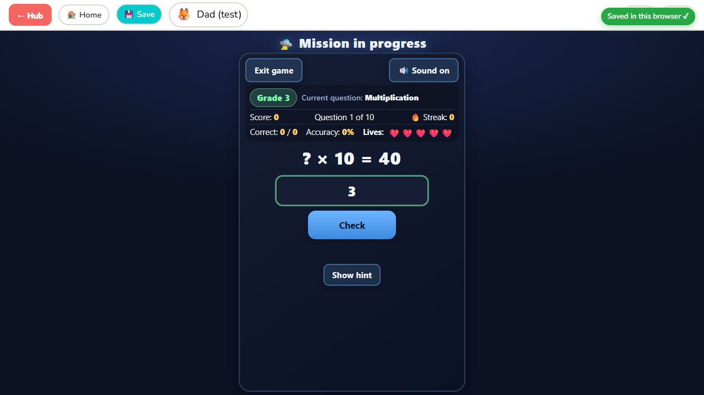
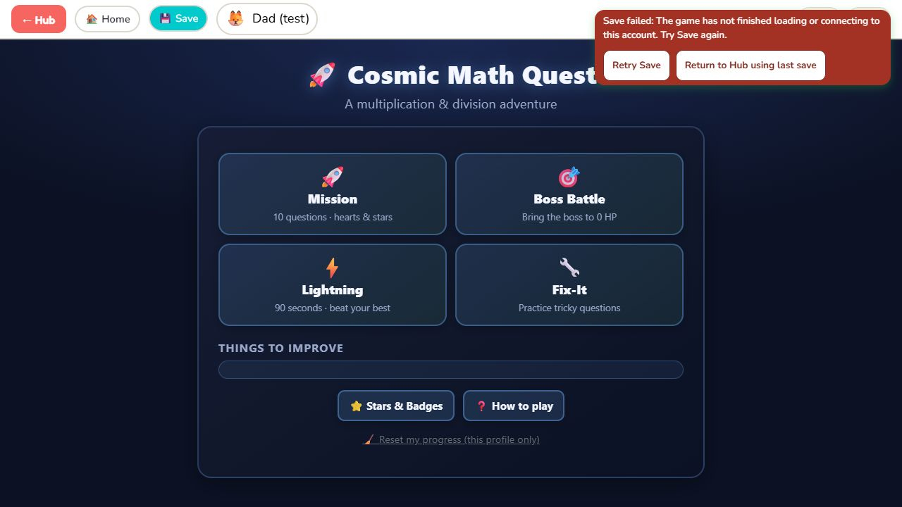
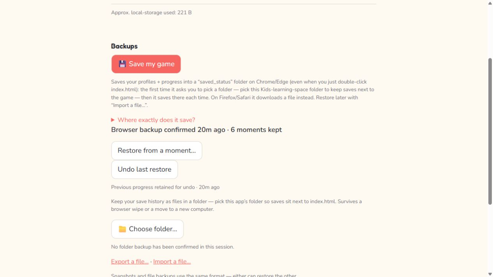

# Reliable saves and recoverable restore

Implemented 2026-10-08. This is option 1 from the save/restore review.
See [the implementation plan](SAVE_RELIABILITY_PLAN.md) and
[game checkpoint record](../games/docs/SESSION_CHECKPOINTS.md).

## What changed

- Save shows Saving, then Saved in this browser only after a matching game
  reply and a confirmed write. Timeout/write errors stay visible. Requests
  and replies carry frame, slug, profile, session, and request identity.
- Profile/navigation changes flush before detaching the iframe. Hidden
  games cannot finish timers and credit another child. Failed rewards and
  session statistics retry without double counting.
- All four games capture exact session state. Continue remains the child's
  choice. Home and Save before Continue preserve the pending session.
  Failed local writes remain reported per key until retried successfully.
- Import validates the complete envelope and raw game JSON before changes,
  displays profile/game scope, and requires REPLACE. Unknown games are warned
  about and skipped; reserved map names and future hub versions are rejected.
- Restore stages and verifies a persistent journal before changing progress.
  Writes are checked; partial failures replay the original values. Interrupted
  journals recover before startup. A persistent failure blocks gameplay and
  profile creation, retaining the recovery copy for Retry recovery.
- Undo last restore/Redo use the retained journal, including without
  IndexedDB. Parent-page confirmations are inline. Preferences, standalone
  saves, folder handles, and browser backup history are preserved.
- Browser snapshot health reflects actual failures instead of API presence.
  Folder status is separate. Downloads are labelled Download requested;
  no claim is made that the browser actually retained the file.
- Manual/automatic disk writes share a serial queue. Server discovery retries,
  failed servers fall back to a connected folder, and throttled changes get a
  deferred write without needing another answer. Disk backups still operate
  when browser snapshot history is unavailable.
- Folder history names are unique, checked, and committed before latest.
  Failed history writes abort and clean up incomplete entries. The Python
  server serializes writes, validates requests, fsyncs temporary files, publishes
  immutable history, then atomically replaces latest. Old filenames still prune.
  An unacknowledged exit beacon never advances the confirmed backup time.

## Startup and Hub recovery update — 2026-10-11

The bridge now acknowledges a profile only after the whole game document has
loaded and its Save/resume handlers are installed. A Save clicked during loading
waits up to ten seconds for connection, then gets a separate 1.5-second checkpoint
reply window. The error distinguishes an unconnected game from an unanswered
checkpoint. Versioned local HTML/script URLs keep the hub and games on the same
save protocol after an update; these assets remain fully offline.

A failed checkpoint no longer traps navigation behind repeated alerts. The
visible failure offers Retry Save or Return to Hub using last save. Leaving
requires an explicit inline confirmation that unconfirmed changes may be lost.
That recovery detaches the failed frame and preserves all existing stored
profiles, game keys, and the last confirmed checkpoint. Late replies are rejected.
An older route waiting on Save also verifies the session and account again
before it can act, so switching accounts cannot restore the previous game's URL.

Long Division Coach now registers profile callbacks after its engine and resume
state exist. Previously an early profile callback could render a null engine.
No Cosmic-specific storage fault was reproduced using older test data; the
reported timeout is handled by the shared startup and recovery changes.

The new full-script startup tests run the actual dependencies, game code, bridge,
and wiring for all four games. They check early/late profiles, immediate parent
resume, active drafts, Save/Home/reopen/Continue, storage failures, and standalone
startup. Shared tests additionally verify delayed connection, recovery cancel
and confirmation, preserved last-save bytes, and stale account/route rejection.
Browser QA confirmed Save and Hub for all four games, exact Cosmic draft Continue,
and a deliberately unresponsive game's recovery buttons, cancel, and return to
Hub. Test profiles and an isolated local origin were used; real saves were not
modified. The temporary failure test page was removed.

Commands passed:

```text
node tests/smoke-save-session.mjs
node games/cosmic-math-quest/tests/smoke-startup-save.mjs
node games/tests/smoke-game-startup.mjs
node games/tests/smoke-session-checkpoints.mjs
```

The existing five Cosmic suites, 400-question grade suite, version-routing
checks, and backup/restore regression suites also pass.





## Compatibility and limits

The backup envelope remains version 1. All existing registered storage keys,
slugs, single-base/multi-base import paths, and old game checkpoint readers
remain. No standalone data is automatically imported into a hub profile.
Playing still requires no network service, framework, package installation,
or build. The existing optional local Python launcher remains optional.

The browser journal is a recoverable staged operation over localStorage,
not a physical multi-key database transaction. It uses additional quota;
if that reserve cannot be retained, restore cancels before changing progress.
If storage is entirely unavailable, the retained copy is kept and recovery
waits for write access. Undo describes the last completed restore and replaces
progress made since that operation when the parent confirms it.

File System Access publishes each closed file separately; history is committed
before latest so there is always a complete new history before publishing it.
The Python service uses atomic filesystem replacement. Windows does not support
directory fsync through this Python path; power-loss guarantees do not exceed
the operating system/filesystem. Cross-device sync is outside option 1.

## Verification

All tests use isolated storage, temporary disk folders, or a separate local
browser test origin. Real saved_status files were not used as test fixtures.

- `node tests/smoke-restore-safety.mjs` — 20 scenarios: strict validation,
  quota/removal/silent-write failures, exact rollback, journal staging/commit
  failures, retained recovery, expired/live leases, Undo/Redo, old formats,
  preference preservation, and IndexedDB error/abort health.
- `node tests/smoke-save-session.mjs` — actual bridge/chrome windows:
  acknowledged saving, source/profile/session/request validation, timeout,
  failure retry, correct reward/stat replay, and flush/detach navigation.
- `node tests/smoke-parent-restore-ui.mjs` — actual UI and storage modules:
  import preview, typed confirmation/cancel, invalid files, inline
  Undo/Redo/timeline flows, failure/retry health, and preserved preferences.
- `node tests/smoke-backup-writes.mjs` — 16 cases: unique histories,
  incomplete-file cleanup, server recovery/fallback, deferred newest revision,
  queue ordering, unavailable IDB, beacon limits, download/ack status,
  permissions, and preservation of valid files when source JSON is corrupt.
- `python tools/test_kls_server.py` — 25 temporary-folder/loopback tests:
  atomic-write failures, concurrent writers, collisions/pruning, schemas,
  Unicode, request origin/host/MIME/size guards, and acknowledgement bytes.
- `node games/tests/smoke-session-checkpoints.mjs` — real capture/restore and
  write helpers for all games, answered/help/scoring flags, timers, review,
  missions, undo history, draft values, restore guards, and retry.
- Existing snapshot, 400-question grade-game, Cosmic wrong-store, and legacy
  790-question validation checks passed; syntax and diff whitespace checked.

Browser observations verified a grade quest's Save confirmation, hub navigation,
restoration of its typed draft, real browser snapshot status, import preflight,
typed confirmation, successful staged replacement, and the retained Undo button.
The test browser's old native confirmation dialog then stalled input. The
production Undo/timeline confirmations were moved inline and are tested through
actual Parent-page handlers; later browser interaction remained limited by that
already-open dialog. Safari/Firefox and direct file:// were not separately
browser-tested in this run. State/failure tests establish persistence behavior,
not a claim of full visual browser coverage for every game.


