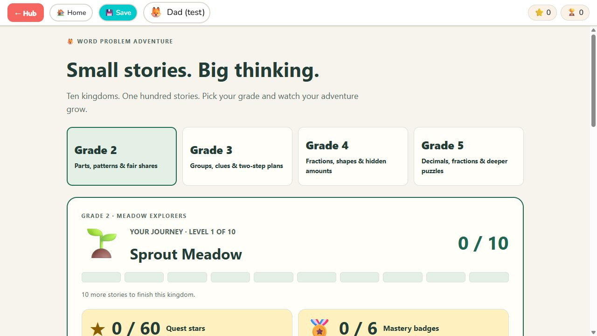
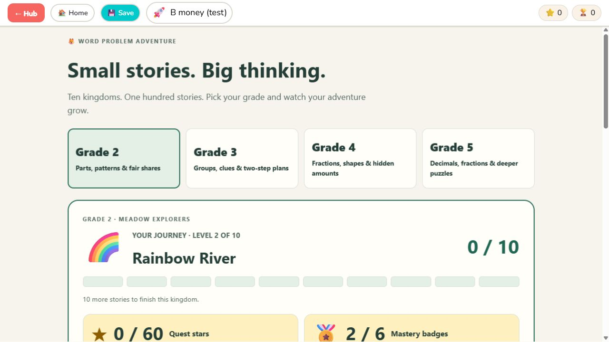
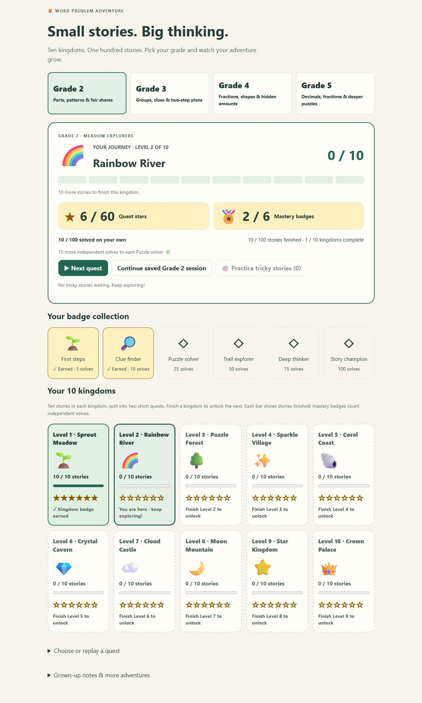
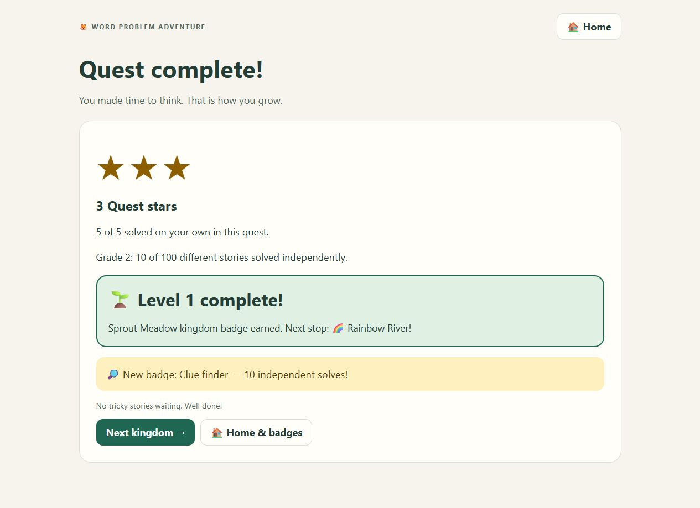
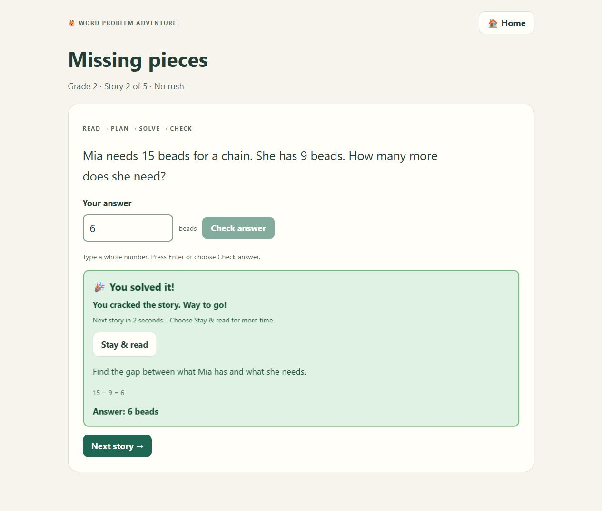
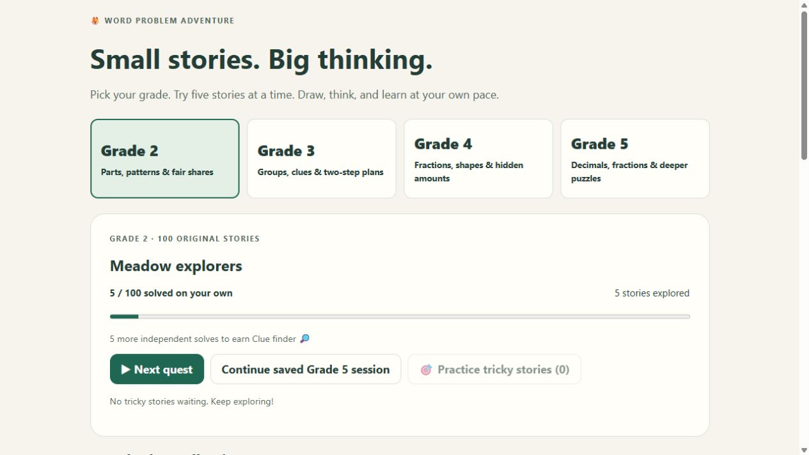
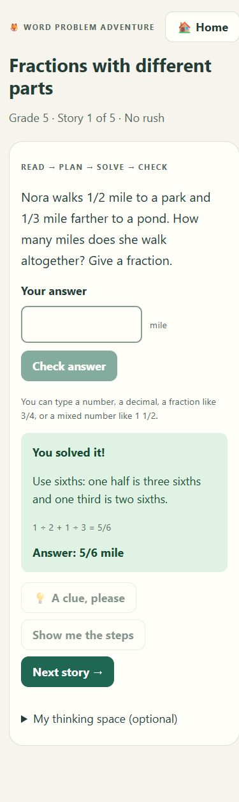

# Word Problem Adventure: grades 2–5

Developed and verified on 2026-09-29.

## Shipped features

- **400 original problems: exactly 100 for each grade, 2–5.** Each grade has
  twenty quests with five stories each. These are authored stories, not
  runtime variations of a handful of templates.
- **Reasoning progression.** Missing quantities, comparisons, reverse
  operations, patterns, fair sharing, irrelevant information, equal-part
  models, constraints, and systematic counting appear alongside arithmetic.
- **Grade-appropriate content.** Grade 2 uses concrete objects and small
  quantities. Grade 3 develops multiplication/division, fractions of sets,
  time, and spatial reasoning. Grade 4 combines larger quantities, fractions,
  factors, measurement, and multi-step constraints. Grade 5 adds fraction
  operations, decimals, volume, equal-part relationships, and deeper puzzles.
- **Child-friendly flow.** Four clear grade buttons, one story per screen,
  visible answer units, five-story sessions, keyboard submission, and an
  always-available Home during play. Correct answers celebrate and move on
  automatically after two seconds; Stay & read pauses for the worked steps.
  There is no time limit for answering and no loss of lives.
- **Teaching support.** A strategy clue, retry feedback, a worked reasoning
  explanation, and a checked number sentence accompany every problem.
  Fractions, equivalent fractions, mixed numbers, and decimals are accepted.
- **Motivation.** Completed quests earn 1–3 stars. Six badges per grade
  celebrate 5, 10, 25, 50, 75, and 100 distinct independent solves: 24 badges
  in total. Badges appear in the home collection and are also sent to the hub.
  Repeats cannot inflate mastery. A hint, miss, or revealed answer excludes
  that attempt from independent mastery; a later fresh solve can earn it.
- **Ten kingdoms per grade.** Each kingdom contains ten stories in two
  five-story quests. Large status cards show stars, mastery badges, current
  level, and ten progress segments. The map shows every level's finished-story
  bar, stars out of six, and a kingdom badge when complete. Finishing all ten
  stories unlocks the next kingdom; the quest summary offers Next kingdom.
- **Practice.** Wrong, hinted, and revealed stories are available for exact
  replay, up to five at a time, oldest first. An independent correct retry
  clears the record. Repeated misses update one record rather than adding
  duplicates. Practice sessions are counted separately from quest stars.
- **Saves and compatibility.** Every graded response or clue checkpoints the
  session, including its position and help/attempt flags. Home, reload, and
  hub return offer Continue. Each profile starts empty. Reset affects only
  the active profile. Existing journeys, daily challenges, and practice remain
  under “Grown-up notes & more adventures.”

## Consistent account edition — 2026-10-11

Every profile now opens the current ten-kingdom homepage. Previously, a saved
journey, practice, or daily checkpoint automatically switched to the earlier
interface; profiles with grade checkpoints stayed on the new one. The difference
came from saved mode routing, not separate copies of the app.

Older sessions are preserved behind Continue earlier adventure. Grade sessions
and earlier sessions can both be retained, saved, reopened, and backed up. The
combined hub checkpoint keeps an optional `earlierAdventure` field, with the
same data also stored in the existing main key's `earlierAdventureCheckpoint`
field. Returning Home captures the earlier draft and stops its timer. Fresh
entries, reset, and profile binding clear the appropriate in-memory offer;
other profiles' records are unchanged. Storage keys and envelope version remain
the same.

Tests pass for v1/v2 journey, practice, and daily saves; latest and fresh
profiles; explicit older Continue; combined Save/Home/reload; profile switching;
reset; and backup roundtrips. The new `smoke-version-routing.mjs` additionally
exercises the actual earlier-engine helpers and shared checkpoint handler.
Browser QA used disposable Dad (test) and B money (test) profiles on an isolated
local origin: both opened the latest homepage, and the older draft survived
Save, Home, account switching, and re-entry. No real account data was used.

## Kingdom journey update — 2026-10-11

Next quest now resumes the saved unfinished quest, including the exact question,
draft, hint, and miss count. It moves past already finished answers instead of
starting the quest at story one. If practice replaced the checkpoint, the next
quest starts at its first unfinished story. Completed quests remain available
as intentional replays under Choose or replay a quest. Completing the entire
grade offers Practice & replay instead of restarting its first quest.

Journey completion is separate from independent mastery. A correct answer
finishes a story even after a hint or retry; a worked example finishes only when
the child explicitly moves on. Mistakes and helped stories still remain in
Practice, and mastery badges keep their first-try, no-help requirements.
Kingdom badges are derived from the ten finished stories and survive reloads;
the existing six mastery badges and hub sticker IDs are unchanged. Each kingdom
offers up to six stars across its two quests, for sixty stars per grade.

The existing grade state gains a profile-scoped `completed` array. Older saves
recover finished stories from independent solves, completed quest stars, and
the saved quest position. A wrong attempt in `seen` alone does not imply
completion. Question IDs, storage keys, and backup envelope version 1 remain
unchanged. Final quest stars and session statistics are saved immediately on
the correct answer; saved reward flags prevent repeating them on Continue.

The smoke test passes all 400 stories, forty kingdoms, twenty-four mastery
badges, exact continuation, level unlocking, intentional replays, final-answer
reward persistence, profile isolation, and old/new backup roundtrips. Browser
checks verified continuation from story three after two previous solves, the
large reward display, both quests in Level 1, its completion message, and the
transition to Level 2. No console warnings or errors were recorded. Responsive
and dark styles remain in place; this update's browser walkthrough used the
default desktop viewport.

## Answer flow update — 2026-10-11

Removed the optional “My thinking space” field from the grade adventures.
Answers are still checked only when the child presses Enter or Check answer.
Every correct submission shows “🎉 You solved it!” with an encouraging message,
then advances after two seconds. The last answer opens the quest or practice
summary. Incorrect answers stay on the question, and Show me the steps keeps
manual Next so the child can read the explanation.

Stay & read pauses the transition and is retained by Save and Continue. Home,
profile changes, replacement quests, and suspension cancel pending transitions;
hidden pages restart a fresh two-second celebration when visible. Saved answered
questions resume only after Continue and never re-grade or repeat rewards. The
removed field's older saved notes remain readable for compatibility. Storage
keys and backup versions are unchanged. Reduced-motion settings disable the
celebration animation.

The grade smoke test completes all 400 stories through automatic advancement
and checks the two-second boundary, cancellation, pause, Save/Continue,
single-delivery rewards, and older checkpoints. Browser checks verified Enter,
the visible celebration, automatic next-story movement, and the removed field.

## Curriculum and editorial record

The [development plan](GRADE_ADVENTURE_PLAN.md) records the public RSM sources
and the grade boundaries. The public descriptions informed the emphasis on
reasoning, unknown quantities, structure, and explaining a plan. The specific
scope and grade placement are our authored enrichment sequence, not a copy
of RSM worksheets or a claim of affiliation/certification.

All 400 stories and their reasoning explanations were reviewed during
authoring for spelling, grammar, familiar vocabulary, short sentences,
unambiguous referents, consistent units, sufficient facts, and one answer.
The longest stories are 34 words in grade 2, 31 in grade 3, 33 in grade 4,
and 34 in grade 5 (whitespace word counts). Reading difficulty is managed
through wording and mathematical prerequisites; these counts are not a
standardized reading-level assessment. No known wording or mathematical
issues remained after the review. Classroom testing with children and an
independent educator review have not been performed.

Every record has an explicit answer and a separate arithmetic check evaluated
with exact rational arithmetic. Logic explanations also state the relevant
reasoning: for example, transfers close a difference twice as fast, endpoints
create one more post than gaps, and a partly filled vehicle still needs a seat.
These source checks support, but do not replace, the editorial review of the
meaning of each story.

## File and storage map

| File | Purpose |
|---|---|
| `data/grade-2.txt` … `data/grade-5.txt` | Editable stories, stable IDs, answers, units, arithmetic checks, reasoning, and quest clues |
| `tools/build_grade_bank.py` | Validates all content and generates the offline bank; `--check` detects stale output |
| `grade-bank.js` | Generated local data; no fetch or server is needed to load it |
| `grade-core.js` | Answer parsing, progress normalization, mastery, milestones, and mistake rules |
| `grade-adventure.js` | Grade chooser, quests, practice, checkpoints, bridge, and profile-safe persistence |
| `grade-adventure.css` | Scoped responsive styles, dark colors, focus states, and reduced-motion rules |
| `tests/smoke-grade-adventure.mjs` | Real engine behavior in an isolated DOM/storage harness |

Main data is an additive `gradeAdventure` field inside
`wordProblemAdventure_v1__<profileId>`. It contains selectedGrade,
per-grade solved/completed/seen IDs, questStars, practiceSessions, and resume.
Mistakes remain in `wordProblemAdventure_wrongs_v1__<profileId>`, grouped
under `byType["Grade N: skill"]`, with qid, grade, missCount, recent answers,
tags, timestamps, correctAnswer, and questionSnapshot.

Both bases were already registered in the hub. The backup envelope version
stays **1**. Standalone play keeps the unscoped keys; embedded play waits for
the profile handshake and never imports standalone data. Writes merge with
the existing main object so earlier game fields survive. Keep question IDs
permanent: do not reuse an ID for a different story or remove a story that a
saved practice queue may reference.

## Verification and completion audit

| Requirement / gate | Evidence and result |
|---|---|
| 100 problems for each of four grades | Compiler passed: 400 distinct texts, unique explicit IDs, 20 quests × 5 problems per grade |
| Correct answers and complete teaching fields | Compiler checked every answer using exact fractions, plus units, clues, explanations, punctuation, and source/output consistency |
| Suitable difficulty and reading | Authored grade/skill progression; all 400 stories and explanations reviewed against the plan's editorial criteria |
| Logical thinking | Eighty quest groupings explicitly train relationships, planning, constraints, and checking, with reasoning explanations |
| Reachable, playable content | Behavioral test completed all 400 real questions through the engine's form handlers and all 80 quest summaries |
| Milestones and reward fairness | All 24 unique badge IDs reached once; repeated solves did not create extra mastery or badges; quest stars capped at 3 |
| Learning from mistakes | Invalid-input, duplicate-miss, corrected-answer, independent replay, hint, reveal, and practice-stat separation checks passed |
| Profile safety | No storage reads before binding; no standalone inheritance; a second profile started empty; reset left other profiles and standalone data intact |
| Save and resume | Tests preserve help/reveal/pause flags and typed drafts; answered Continue advances without re-grading or repeating rewards |
| Backup compatibility | Actual backup module exported/imported new progress and mistakes byte-for-byte; old single-base backup restored earlier journey data with an empty new grade path |
| Offline structure | Every script/style URL is local and resolves; no runtime network calls in the new engine; no build system or package dependency added |
| Ease of use | Browser exercised grade selection, a five-story quest by keyboard, gentle retry, practice, first badge, equivalent fractions, hub Home, Save/return, and legacy entry |
| Responsive layout | Browser checked a 390 × 844 viewport; page width did not exceed viewport; large controls and wrapped story text inspected visually |
| Earlier adventures | Existing validator passed all 790 legacy questions; journey map opened in the browser; hidden legacy controls now honor the hidden attribute |
| Feature records | This release record, the plan, README, and both mistakes/practice documents updated |

Commands run successfully:

```text
python games/word-problem-adventure/tools/build_grade_bank.py --check
node games/word-problem-adventure/tests/smoke-grade-adventure.mjs
node tests/smoke-backup-snapshots.mjs
python games/word-problem-adventure/tools/validate_banks.py
node --check games/word-problem-adventure/grade-core.js
node --check games/word-problem-adventure/grade-adventure.js
git diff --check
```

The existing legacy validator had an open temporary-file handle that prevented
cleanup on Windows. It now closes that handle before running Node and deleting
the temporary file. The validator then passed without changing legacy content.

Browser checks used a local HTTP server and an isolated test profile. No console
warnings or errors appeared in the inspected game and hub sessions. The browser
tool permits only HTTP/HTTPS and blocked direct `file://` navigation, so that
specific launch mode was checked structurally rather than exercised. Safari,
Firefox, and dark-mode rendering were not independently browser-tested; their
existing support paths and the new CSS media rules remain in place.

## Visual record














